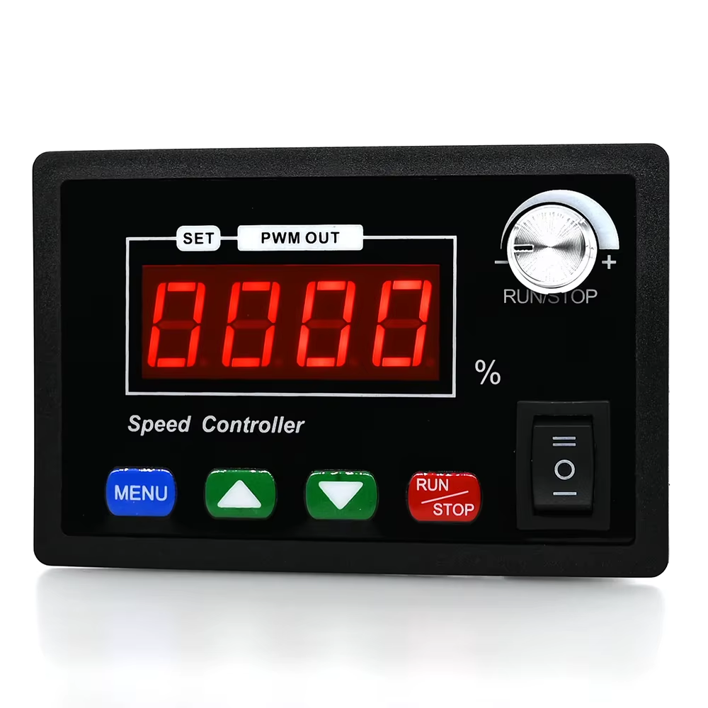

# Manual do controlador de velocidade

Tradução do folheto **User Manual for DC Digital Display Governor** fornecido com a bancada.

## Uso na bancada

Pressione o **botão giratório prateado (RUN/STOP)** e depois ligue a chavinha. O painel indica o ajuste em porcentagem. Confira a rotação em RPM com o tacômetro.

## Dados do folheto

| Item | Informação |
| --- | --- |
| Alimentação | 6 a 55 V em corrente contínua (CC) |
| Corrente máxima | 20 A |
| Visor | Digital de 4 dígitos |
| Tipo de ajuste | Regulagem de corrente |
| Comandos de ajuste | Botões e botão giratório |
| Frequência de controle | 15 kHz |
| Carga indicada | Motor CC sem escovas, conforme o texto do folheto |
| Sentido de giro | Avanço e reversão |
| Instalação e terminais | Encaixe em painel, bornes tipo barreira |
| Peso líquido | 88 g |
| Dimensões | 77 mm de largura × 57 mm de altura × 38 mm de espessura |
| Abertura no painel | 72 mm de largura × 52 mm de altura |

## Ligações descritas no folheto

O folheto indica alimentação CC entre 6 e 55 V, com tensão igual à nominal do motor. Respeite as polaridades. **Não ligue a entrada diretamente à rede de corrente alternada (CA).**

| Borne | Ligação |
| --- | --- |
| ④ | Positivo da alimentação |
| ③ | Negativo da alimentação |
| ② | Positivo do motor |
| ① | Negativo do motor |

## Funções

| Função | Ajuste |
| --- | --- |
| 1 | Partida suave, de 000 a 100 (0 a 10 s). Padrão de 1 s. |
| 2 | Parada suave, de 000 a 100 (0 a 10 s). Padrão de 1 s. |
| 3 | Limite inferior de velocidade, de 000 a 9980. Padrão de 0. |
| 4 | Escala do visor, de 000 a 9990. Padrão de 100. |
| 5 | Passo de aumento ou redução a cada toque. Opções 001, 002, 005, 010, 015, 020, 025, 050 e 100. |

Nas funções 3 e 4, o folheto indica que, acima de 999, o algarismo dos milhares pisca na tela de configuração.

| Função 6 | Função 7 | Comportamento |
| --- | --- | --- |
| Modo 1 | Modo 1 | Liga sem partida automática. |
| Modo 2 | Modo 1 | Liga com partida automática. |
| Modo 1 | Modo 2 | Funciona enquanto o comando é pressionado e para ao soltá-lo. |
| Modo 2 | Modo 2 | Para enquanto o comando é pressionado e volta a funcionar ao soltá-lo. |

Para restaurar os ajustes de fábrica, entre nas configurações e mantenha o botão de configuração pressionado por 8 segundos. O visor pisca uma vez quando a restauração é concluída.
